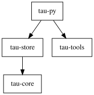

# As-built metrics, Phase 3d (workstream A)

Measured 2026-10-29 on master at `8a07abf` plus the working tree that adds
`scripts/ratchet.py` and friends. The review measures `crates/` with the Rust
equivalents of the τ 0.15 architecture review tools and sets rule 7's ratchet.
It measures; it fixes nothing. The violations below are the ratchet's
allowlist (`scripts/ratchet-allow.toml`), and the fixes are a later wave.

## Tools

| purpose | tool | version |
|---|---|---|
| CC, cognitive, LOC per function | `rust-code-analysis-cli` | 0.0.25 |
| coverage | `cargo-llvm-cov` (+ rustup `llvm-tools-preview`) | 0.9.1 |
| unused dependencies | `cargo-machete` | 0.9.2 |
| module / item graphs | `cargo-modules` | 0.28.0 |
| crate graphs | `cargo-depgraph` | 1.6.0 |
| rendering | graphviz `dot` | 2.43.0 |
| compiler | rustc | 1.99.1 (2026-10-13) |
| τ 0.15 baseline | `radon` (throwaway venv) | 6.0.1 |
| "core depends on no IO" | `cargo metadata` + text scan, `scripts/check_core_io.py` | (stdlib only; no guppy) |

The Rust tool versions are pinned in `scripts/ci-toolchain.sh`.

## What is counted, and how

Definitions live in the docstring of `scripts/rustmetrics.py`; the short form:

- **Function CC** is 1 + decision points in the function's span, closures
  included (radon folds nested functions into the parent the same way).
  **Cognitive** and **LOC** (`sloc` of the span) come straight from
  rust-code-analysis.
- **src vs tests.** "tests" are `crates/*/tests`, `crates/*/benches`, and the
  `#[cfg(test)] mod tests` blocks inside `src/` files (the five `tau-tools`
  files; 1,133 of the 7,119 src lines). File line counts are whole files,
  inline tests included, because rule 7 says "no file over 800 lines".
- **Methods per type** counts functions directly inside `impl` blocks,
  summed across blocks per (crate, type). Inherent impls and trait impls are
  counted separately; only inherent counts are gated. The two `Session`s
  (`tau-core`, `tau-py`) are different types.
- **Limits of the tools.** rust-code-analysis parses macro bodies as token
  trees, so functions inside `proptest! { ... }` are not measured (they are
  test code). `crates/bench-formats` is outside the workspace (its own
  lockfile) and is not measured.

## Headline: crates/ against τ 0.15

Distributions, not totals. τ 0.15 is the four `tau-*` source distributions
plus `tau-meta` (radon, `scripts/py_baseline.py`); its numbers match the
existing `scripts/arch` report (3,301 functions, 222 over CC 10).
Raw data: `data/summary.json` (Rust), `data/tau015-python.json` (τ 0.15).

### Source

| | trusty `crates/*/src` | τ 0.15 `src` |
|---|---:|---:|
| files | 18 | 176 |
| lines | 7,119 | 99,233 |
| functions | 315 | 3,301 |
| CC max | **30** | 73 |
| CC p90 | 8 | 8 |
| CC p99 | 21 | 21 |
| CC mean | 3.32 | 3.87 |
| functions over CC 10 | 17 (5.4%) | 222 (6.7%) |
| functions over CC 15 | **5** (1.6%) | 85 (2.6%) |
| functions over CC 20 | 4 | 35 |
| functions over CC 40 | 0 | 5 |
| function LOC max / p90 | 102 / 24 | 336 / 44 |
| functions over 50 lines | 6 | 258 |
| file lines max / p90 | 867 / 750 | 6,510 / 1,256 |
| files over 800 lines | **1** | 32 |
| files over 1,500 lines | 0 | 12 |
| largest type by methods | 47 (`tau-py::Session`) | 216 (`AgentSession`) |
| types over 25 methods | **3** (inherent) | 22 |

The p90 and p99 of CC are equal to τ 0.15's; the difference is entirely in
the tail. Cognitive complexity (not measured for τ 0.15): max 18, p90 3,
none over 25 (which is also what the workspace's `clippy::cognitive_complexity
= "deny"` holds).

Per crate (src):

| crate | files | lines | functions | max CC | over 10 | over 15 |
|---|---:|---:|---:|---:|---:|---:|
| tau-core | 4 | 1,910 | 98 | 30 | 3 | 2 |
| tau-store | 1 | 311 | 16 | 15 | 2 | 0 |
| tau-tools | 7 | 3,206 | 86 | 24 | 10 | 2 |
| tau-py | 6 | 1,692 | 115 | 21 | 2 | 1 |

### Tests

| | trusty `tests/` + `benches/` + inline `mod tests` | τ 0.15 `tau-*/tests` |
|---|---:|---:|
| files | 7 (+5 inline modules) | 415 |
| lines | 4,277 (+1,133 inline) | 142,491 |
| functions | 264 | 9,324 |
| CC max / p90 | 16 / 5 | 32 / 6 |
| over CC 10 | 4 | 123 |
| over CC 15 | 1 | 29 |
| files over 800 lines | 3 | 28 |

Not gated (rule 7 is about `crates/*/src`). The Python test suite
(`tests/`, 269 passed, 3 skipped) is Phase 4's to measure.

The three test files over 800 lines: `tau-core/tests/step.rs` 1,170,
`tau-store/benches/tree.rs` 920, `tau-core/tests/machine.rs` 823.

## Top 15 functions by CC (src)

| CC | cognitive | where | function | LOC |
|---:|---:|---|---|---:|
| 30 | 18 | `tau-core/src/step.rs:299` | `Step::feed` | 91 |
| 29 | 18 | `tau-core/src/step.rs:188` | `Step::job` | 102 |
| 24 | 16 | `tau-tools/src/read.rs:80` | `Read::run` | 74 |
| 21 | 0 | `tau-py/src/error.rs:209` | `add_all` | 24 |
| 16 | 6 | `tau-tools/src/bash.rs:428` | `Running::read_output` | 45 |
| 15 | 2 | `tau-store/src/lib.rs:134` | `Store::open` | 30 |
| 14 | 1 | `tau-core/src/tree.rs:181` | `Error::fmt` | 17 |
| 14 | 1 | `tau-py/src/error.rs:175` | `tree_err` | 19 |
| 14 | 7 | `tau-tools/src/bash.rs:365` | `Running::supervise` | 32 |
| 14 | 12 | `tau-tools/src/bash.rs:479` | `Running::answer` | 37 |
| 14 | 14 | `tau-tools/src/grep.rs:200` | `Grep::render` | 65 |
| 14 | 5 | `tau-tools/src/write.rs:115` | `replace` | 33 |
| 13 | 2 | `tau-tools/src/bash.rs:154` | `Bash::spawn` | 63 |
| 12 | 4 | `tau-tools/src/grep.rs:121` | `Grep::run` | 26 |
| 11 | 1 | `tau-store/src/lib.rs:94` | `Store::create` | 30 |

`add_all` has CC 21 but cognitive 0: it is a flat list of `m.add(...)`
calls. `Step::feed` and `Step::job` have both CC and cognitive at 18 or more
and are the heart of the step machine.

## Rule 7 violations (the ratchet allowlist)

`scripts/ratchet.py` against `scripts/ratchet-allow.toml`: 9 violations,
all listed with their current value.

| rule | item | now | limit |
|---|---|---:|---:|
| function CC | `tau-core/src/step.rs` `Step::feed` | 30 | 15 |
| function CC | `tau-core/src/step.rs` `Step::job` | 29 | 15 |
| function CC | `tau-tools/src/read.rs` `Read::run` | 24 | 15 |
| function CC | `tau-py/src/error.rs` `add_all` | 21 | 15 |
| function CC | `tau-tools/src/bash.rs` `Running::read_output` | 16 | 15 |
| methods | `tau-py::Session` (PyO3 class, 2 impl blocks) | 47 | 25 |
| methods | `tau-core::Machine` | 40 | 25 |
| methods | `tau-core::Session` | 36 | 25 |
| file lines | `tau-tools/src/bash.rs` (517 before its `mod tests`) | 867 | 800 |

Banned-term count: 0. I7: both property tests exist and run in `cargo test`
(`replay.rs::reload_at_any_sync_equals_the_state_at_that_sync`,
`store.rs::a_torn_tail_opens_as_the_last_sync_before_it`).

Near the limit (so the next change trips it): `Store::open` CC 15;
`tau-core/src/tree.rs` 750 lines, `tau-tools/src/grep.rs` 746,
`limit.rs` 713.

Behavior of the ratchet (`scripts/ratchet.py`): fails on `NEW` (over the
limit, not listed), `WORSE` (listed, grew), `FIXED` (listed, now within the
limit), `BETTER` (listed, shrank but still over: lower the number) and `GONE`
(listed, no longer exists). `--tighten` rewrites the allowlist to the
improved values and never raises one.

Inherent-method counts in the top types (trait impls separately, none
over 3): `tau-py::Session` 47, `Machine` 40, `Session` 36, `Step` 17,
`Sink` 9. Largest trait-impl count on any type: 3.

## Dependencies

### Crates



`tau-py -> tau-store -> tau-core` and `tau-py -> tau-tools`. `tau-tools` does
not depend on `tau-core` or `tau-store`. No cycles (cargo forbids them).
With every external crate: `svg/deps-all.svg`.

### tau-core is IO-free

`scripts/check_core_io.py` (runs in `check.sh`) passes:

- shipped (normal + build) closure of `tau-core`, 7 packages: `serde`,
  `serde_core`, `serde_derive`, `proc-macro2`, `quote`, `syn`,
  `unicode-ident`. None of tokio, async-std, smol, futures, mio, pyo3, libc,
  rustix, nix, tempfile and others on its denylist.
- dev-only closure (via `proptest`) does pull `libc`, `rustix`, `tempfile`,
  `rand`; they are not shipped and are exempt. Listed in `data/core-io.txt`.
- no `std::fs`, `std::net`, `std::process`, `std::io`, `std::thread`,
  `std::env`, `async fn`, or `.await` in `crates/tau-core/src`.

### Modules

Module graphs (`uses` edges only) in `svg/modules-<crate>.svg`; item-level
graphs (types included) in `svg/items-<crate>.svg`; edge lists in
`data/module-edges.txt`. All four are acyclic by inspection: `tau-core` is
`machine -> step -> tree` and `machine -> tree`; `tau-tools` has
`bash`, `grep`, `read`, `write -> limit -> lib` and `bash -> session`;
`tau-py` has `lib -> {job, session, tools, values}`,
`session -> {error, job, values}`, `job, tools -> values`.
(`cargo modules --acyclic` fails on every crate because it counts an item
and its own methods as a cycle, so it cannot be used as a gate.)

### Unused dependencies and dead code

- `cargo machete` (`data/machete.txt`): one finding, `grep-matcher` in
  `crates/tau-tools/Cargo.toml`. No source file names `grep_matcher`.
  Confirm it is not needed for a trait import before removing it (workstream
  B owns Cargo files; not touched here).
- Dead code: no crate sets `#![deny(dead_code)]`, and the workspace lints do
  not name it. It is `warn` by default and `scripts/check.sh` runs clippy with
  `-D warnings`, so unused private items already fail the gate. `pub` items
  in the library crates are not flagged by rustc; there is no vulture
  equivalent for those. The only `allow` in `src` is
  `clippy::unused_self` in `tau-py/src/tools.rs` (`data/lints.txt`). Not
  changed here. τ 0.15 had 379 vulture candidates, 62 of them with
  uncovered statements.

## Coverage

`scripts/coverage.sh`, reported and never gated; data in `data/coverage-*.{txt,json}`.
Debug build, rust-llvm instrumentation. Python tests drive the instrumented
cdylib built by `maturin develop`, so coverage from `pytest tests/` lands in
`tau-core`, `tau-store`, `tau-tools` and `tau-py` source. Inline
`#[cfg(test)]` modules in `tau-tools` count toward their own files (1,133
lines, mostly covered by the Rust tests), so `tau-tools` percentages are
flattered for the Rust-only run.

| | Rust tests | pytest through cdylib | both |
|---|---:|---:|---:|
| lines | 71.8% (3067/4274) | 73.3% (3133/4274) | **94.8%** (4051/4274) |
| functions | 59.5% | 71.5% | 89.5% |
| regions | 75.1% | 66.4% | 94.2% |
| tau-core | 93.1% | 93.4% | 97.7% |
| tau-store | 93.4% | 94.0% | 98.4% |
| tau-tools | 89.8% | 52.8% | 93.8% |
| tau-py | 0% (no Rust tests) | 92.8% | 92.8% |

τ 0.15: 92.1% line (34,343 statements), 90.3% line + branch. These are
different measures (statements vs LLVM lines), so read the comparison as
"same ballpark", not as a delta. Branch coverage is not available on stable
LLVM output here (`Branches` columns are `-`).

Least-covered files, both runs combined:

| file | lines | missed | cover |
|---|---:|---:|---:|
| `tau-tools/src/session.rs` | 53 | 17 | 67.9% |
| `tau-py/src/values.rs` | 193 | 27 | 86.0% |
| `tau-py/src/job.rs` | 94 | 10 | 89.4% |
| `tau-tools/src/bash.rs` | 552 | 52 | 90.6% |
| `tau-tools/src/limit.rs` | 487 | 38 | 92.2% |
| `tau-py/src/tools.rs` | 142 | 9 | 93.7% |
| `tau-py/src/error.rs` | 65 | 4 | 93.8% |

Every other file is at 94.9% or above. By Rust tests alone the zeros are
all of `tau-py` (it has no Rust tests; the Python suite is its test), and
`tau-tools/src/session.rs` is lowest at 67.9% there too.

## Reproduce

```bash
source ~/.cargo/env
# one-time tools (versions above; scripts/ci-toolchain.sh installs them in CI)
rustup component add llvm-tools-preview
cargo install --locked rust-code-analysis-cli cargo-llvm-cov cargo-machete cargo-modules cargo-depgraph
# graphviz for the SVGs: apt install graphviz

scripts/check.sh            # includes the ratchet and the core IO check
scripts/ratchet.py          # alone, via .venv/bin/python
scripts/ratchet.py --tighten  # after fixing a violation: lower or drop allowlist lines
scripts/metrics.sh          # rewrites data/ and svg/ (not coverage)
scripts/coverage.sh         # rewrites data/coverage-*; ~1.5 min; swaps in and out an
                            # instrumented python/tau/_core*.so, restores the release build

# the τ 0.15 baseline (radon 6.0.1 in a throwaway venv, not the repo's)
python3 -m venv /tmp/radonvenv && /tmp/radonvenv/bin/pip install radon==6.0.1
/tmp/radonvenv/bin/python scripts/py_baseline.py ~/Development/tau \
  --src tau-llm/src tau-agent-core/src tau-coding-agent/src tau-jmfts/src tau-meta/src \
  --tests tau-llm/tests tau-agent-core/tests tau-coding-agent/tests tau-jmfts/tests \
  > docs/as-built/metrics/data/tau015-python.json
```

CI: `gate` runs `check.sh` (ratchet included); a separate non-gating `report`
job runs `metrics.sh` and `coverage.sh` and leaves the numbers in the log.

## Files

| path | what |
|---|---|
| `data/summary.json` | Rust distributions, top lists, per-crate (src and tests apart) |
| `data/rust.json` | every function, type and file measured |
| `data/tau015-python.json` | τ 0.15 baseline, same fields |
| `data/coverage-{rust,py,both}.{txt,json}` | llvm-cov reports |
| `data/machete.txt`, `data/lints.txt`, `data/core-io.txt`, `data/module-edges.txt` | tool outputs |
| `svg/` | crate, module, and item graphs |
