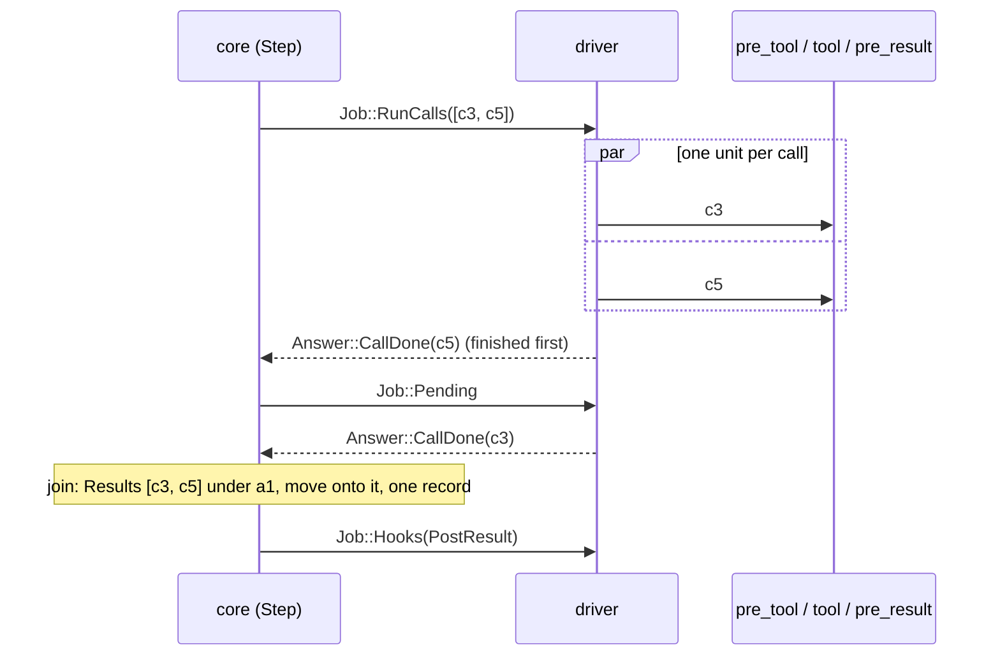

# 01 The step, as the spike runs it

`step::Step` hands out a `Job`; the driver does it and answers with an `Answer`.
The tests in `crates/tau-core/tests/step.rs` are the worked examples; this
page is the shape they share.

## Positions and jobs

```
 Step::wake(session, cursor, asked, now)
   │
   ▼ PreStep ──── Job::Hooks(PreStep) ───────────────────────── Answer::Hooks
   ▼ Input        while input is pending (and auto-step on, or asked):
   │                Job::Hooks(PreInput, draft{User(text), delivers [item]})
   │                Answer::Hooks{draft} ─▶ Session::write: User under at + move
   ▼ PreSample    if next == Sample:  Job::Hooks(PreSample)
   │                Answer::Hooks{draft: Some(reply)} answers it ─▶ skip to PreReply
   ▼ Sample       Job::Sample ──────────────────────────────── Answer::Sampled{reply, error}
   ▼ PreReply     Job::Hooks(PreReply, reply) ─────────────── Answer::Hooks ─▶ write under at
   ▼ PostReply    Job::Hooks(PostReply)
   ▼ Tools        if next == RunTools:  Job::RunCalls([RunCall…])
   ▼ Calls        Job::Pending until an Answer::CallDone for every call
   │                join: Results in call order ─▶ Session::write
   ▼ PostResult   Job::Hooks(PostResult)
   ▼ PostStep     Job::Hooks(PostStep, ending)
   │
   ├─ Done, and (auto-step on with work) or the scratchpad changed
   │     the cursor moved since the step woke ──▶ Step::wake again, from PreStep
   │     the cursor did not move, auto-step on ──▶ auto-step off, Rest
   │       (a scratchpad change alone still wakes one step, auto-step as it is)
   └─ otherwise ──▶ Rest: Job::Rest
```

Each phase checks its condition when it starts, against `at` as hooks left
it. A string in any `Answer::Hooks` before `PostStep`, or an `Answer::HookFailed`,
jumps straight to `PostStep` with `Halted` or `Failed`, and auto-step goes
off.

## Who moves `at`

```
 u1 ─ a1           pre_reply hook: write x1 under u1, move onto it
 └ x1 ◀ A.at       the reply was sampled from walk(u1)
   └ a1' ◀ A.at    commit: a1' under x1, wherever at stands now
                   (pre_reply_move_chooses_where_the_reply_lands)
```

Only cursor hooks and commits move the cursor during a step. Tool hooks run
inside `RunCalls` and have no cursor, so `at` stays on the batch until the
join.

## A batch, driver side



## Abort

```
 Step::abort(session) ─▶ auto-step off; no later phase applies
   returns true at Sample or Calls: cancel the effect and answer what arrived
     Sample: Answer::Sampled{reply: partial, stop Interrupted} ─▶ pre_reply, commit, post_reply
             nothing arrived: Answer::Sampled{None, None} ─▶ PostStep(Aborted)
     Calls:  Answer::CallDone(Interrupted) for each unfinished call ─▶ join as usual
   returns false at a hook: the hook finishes; later effects don't start
```

## After a crash mid-batch

```
 on disk:  k0 ─ s ─ u1 ─ a1 [c3, c5, stop Tools] ◀ A.at      no outcomes
 reconcile: A at rest, auto-step off; next == RunTools

 send "the power went out"   ─▶ u2 under a1; the provider renders c3, c5 as text
 Session.step, no input      ─▶ RunCalls([c3, c5]) again; r1 under a1
```
