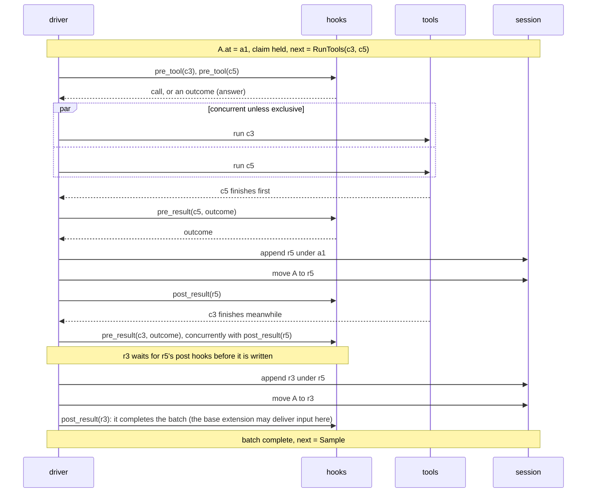

# 02 The step

A step is one cycle for one cursor. It has five phases: pre hooks on the
effect, the effect, pre hooks on the node, **write then move**, post hooks on
the written node. There are three step kinds. `input` writes a body an input
hook handled input with; `sample` makes one provider request and writes one
`Assistant` node; `tools` runs every unanswered call and writes one `Result`
per call, moving onto each as it is written. After the step the driver
evaluates `next(walk(at))` and, with auto-step on, keeps stepping until
`next` is `Wait`. Pre hooks change what is written; post hooks change what
happens around a written node. Every hook is `hook(cursor, subject)` and may
act through its cursor at any hook point. A step holds its cursor's **step
lock** from start through its post hooks and the `next` that follows; that is
what **busy** means. A move of a busy cursor from outside its step interrupts
the step in place: its records are written and moved onto, then the move
applies.

## The five phases

```
 1 pre hooks      2 effect         3 pre hooks       4 write + move       5 post hooks
   on the effect                     on the node       (durable together)   on the written node
 ────────────────────────────────────────────────────────────────────────────────────────────
 input   (none)        (none)        (none)            append, move onto    post_input
         (the body an input hook handled input with: pre_input runs before, outside the step)
 sample  pre_sample    provider      pre_reply         append, move onto    post_reply
 tools   pre_tool      run the tool  pre_result        append, move onto    post_result
         (per call)    (per call)    (per call)        (per result)         (per result)

 then: next(walk(at))  ──▶  Sample | RunTools | Wait
       auto-step on: step again until Wait       auto-step off: cursor pauses, already moved
```

Hooks at one point run in the order listed in `config_at(at)`; each gets what
the previous one returned. A cursor is **busy** from the step's start to its
last post hook. `post_open` runs outside steps, when a cursor opens or a
session loads.

## Sample step

```
 A.at = u1 (User)        next = Sample

 pre_sample(tip = u1)
   │  returns tip'   ......... u1 itself, a node it appended (a reminder), a Config
   │                           (model choice), or the end of a line it built (compaction)
   │  returns a reply  ....... ANSWER: provider not called, remaining pre_sample hooks skipped
   │  raises  ................ hook error: nothing written, auto-step off
   ▼
 driver: apply I6 to tip'   ·   can a reply be appended under tip'? (I4) else refuse the step
   ▼
 provider.sample( walk(tip'), config_at(tip') )          stream_delta events; parts accumulate
   ▼
 pre_reply(reply)
   │  returns reply' ......... parts possibly rewritten (guard, redaction), never `stop`;
   │                           also runs after an ANSWER
   │  returns nothing ........ REFUSE: nothing written, its calls never existed, auto-step off
   ▼
 append Assistant a2 under tip'     by provider   (extension(name) if answered or rewritten)
                                    (under I6's restating Config instead, if the driver appended one)
 move A: u1 ──▶ a2                  by core       commits tip''s line, then a2
   ▼
 post_reply(cursor, a2)   runs unless the step was interrupted; A's lock is still held
   │  may append side nodes (scratch); may write "continue" (cursor.write)
   │  may move or rerun any cursor; a move of A here is inside the step and interrupts
   │  nothing: the later post_reply hooks still run on a2, seeing cursor.at where it now is
   ▼
 next(walk(at))           still under A's lock; then the lock is released
```

## Tools step

```
 A.at = a1 (Assistant, stop = tools, calls c3 and c5)     next = RunTools(c3, c5)
 A's step takes a1's claim (waits if another step holds it), re-reads the run

 per call                 pre_tool(call)
                            │ returns call'   rewritten (sandbox, remote host)
                            │ returns outcome ANSWER: Ok (cache, mock) or Skipped("blocked by ...")
                            │                 tool not run; pre_result still runs
                            │ raises          the call is answered Err("hook error") by core
                            ▼
                          run the tool      c3 and c5 run concurrently unless a tool is exclusive
                            ▼
                          pre_result(call', outcome)   as soon as this tool finishes, concurrently
                            │ returns an outcome of the same kind; content may be redacted
                            │ cannot drop it: every call is owed a result (I4)
                            ▼ (results wait in line, in completion order)
 one at a time per cursor append Result under the previous node (a1 for the first)
                          move A onto it                 by core
                          post_result(node) finishes     before the next outcome is written
                            │ may append side nodes, or act through its cursor
                            │ moving A before the batch is complete: applied when the hook returns;
                            │ the calls still running are answered Interrupted under the run and
                            │ moved onto (not waiting behind post hooks), then the move
```



A call whose `args_raw` does not parse is answered `Err("invalid arguments")`
(by core) without running. Results core writes (`Err("invalid arguments")`,
`Interrupted`, `Err("hook error")`) skip `pre_result`: there is nothing to
rewrite. They are written and moved onto, and their `post_result` hooks run,
so a hook that waits for the completing result always sees it. Under a reply with any other `stop`, no call runs
and none is owed a result.

## Input

```
 frontend: Session.input(A, "fix it too")       A busy or at rest; nothing else in core looks at input
   ▼
 pre_input(cursor, input)   each hook, in config order
   │  HANDLED, with a body ...... an input step writes it under at and moves onto it (by core),
   │                             then post_input; on a busy cursor the step is interrupted in place first
   │  HANDLED, no body .......... the hook did all it meant to (e.g. wrote a pending input)
   │  PASS (input') ............. the next hook gets input', possibly rewritten
   │  REFUSE (reason) ........... nothing written; Session.input raises; the frontend keeps the text
   │  every hook passes ......... REFUSED: "no extension handled this input"
   ▼
 input step: append (by frontend if it is the input as given, else extension(name)); move A onto it
   ▼
 post_input(cursor, node)   e.g. write a sibling u1' with derived_from [u1] and move onto it;
   ▼                        the typed u1 stays, committed
 next(walk(at))
```

## The base extension: busy input, pending inputs, delivery

```
 k0 Config ─ s ─ u1 ─ a1 [c3, c5] ─ r5 ◀ A.at        A is busy: c3 still running
 └ p1  Custom{kind: pending_input,     by extension(base)   Session.input(A, "also check b.rs")
         cursor: A, text: "also check b.rs"}                 while busy: pending, handled, no body
                                                             (a side node directly under the first root)

 c3 finishes:  r3 written under r5, A moved onto it (by core); the batch is complete
 post_result(cursor, r3), the base extension's hook (deliver: after_batch):
   pending for A = pending_input nodes for A that no node copies from = [p1]   (reverse index: one lookup)
   cursor.write( User "also check b.rs", copied_from: [p1] )               one durable write: node + move
   other post_result hooks on r3 run too, before or after it, whatever the config order

 k0 ─ s ─ u1 ─ a1 ─ r5 ─ r3 ─ u2 ◀ A.at      u2 by extension(base), copied_from [p1]    next = Sample
 p1 is delivered: u2 copies from it. No other marker; a crash cannot deliver it twice.
```

- A cursor's input hooks and post hooks never run concurrently. Input that
  arrives while the post hooks run waits until the step releases its lock,
  and then finds the cursor at rest. So a pending input is always written
  before the post hooks that could deliver it, or not at all.
- At rest, the base extension handles input with a `User` body. If inputs
  are still pending for the cursor, it adds this one as pending and handles
  it with one `User` body for all of them, `copied_from` listing them, so
  order is kept and `post_input` runs.
- At rest at an unstarted or partial batch, it writes a pending input and
  steps the cursor; the batch is answered first (Q17).
- `deliver: after_stop` waits for a `post_reply` on a reply that is not a
  batch. `combine: false` writes one `User` node per pending input.
- After a reload, its `post_open` delivers what is still pending, if `at` can
  take a `User` node (`06-crash-and-resume.md`).

## What a hook may do

Every hook point gets the same cursor handle, bound to the hook's extension:

```
 read   cursor.at   cursor.next   cursor.busy   cursor.auto_step   cursor.session (every node, every cursor)
 act    append side nodes      cursor.write(body)  (append under at + move, one durable write)
        move / rerun any cursor      set auto-step      step      abort      open cursors
        sample a walk and run a tool, outside any step (a cold summary on a detached root)
```

No hook point forbids any of these; the tree decides what each does:

| situation | what the action does |
|---|---|
| append or move breaks I3, I4, or I6 | refused; raises into the hook, which may catch it |
| another cursor is busy, or this cursor is moved from outside its step | its step is interrupted in place, then the move applies (below) |
| a hook of the step moves its own cursor from a pre hook, or from `post_result` mid-batch | the move is a request, applied when the hook returns: interrupt in place, then move |
| a post hook moves its own cursor after the step's own move | inside the step: nothing is interrupted; the other post hooks on the node still run, and see the new `cursor.at` |
| two post hooks on one node both move | two real moves, in config order |
| the moved cursor is at rest | the move lands; when the hook returns, the driver carries on per auto-step |
| a hook writes a node or a move | no hooks run for it; a step it causes runs hooks as usual |
| a hook opens a cursor | the new cursor's `post_open` runs (Q32) |

What a hook *returns* still steers its own hook point: rewrite, answer, or
refuse, as before.

| hook point | rewrite | answer | refuse |
|---|---|---|---|
| `pre_input` | pass a rewritten input | handled (optionally with a body) | refuse (a reason) |
| `pre_sample` | return a different tip | yes: a reply | no |
| `pre_reply` | yes, never `stop` | n/a | yes |
| `pre_tool` | yes | yes: `Ok` or `Skipped` | no: answers `Skipped` instead |
| `pre_result` | content only, never the kind (Q18) | n/a | no |
| post hooks, `post_open` | n/a | n/a | n/a |

## Moving a busy cursor

```
 A is sampling: context tip u1, parts streaming, A holds its lock
 a frontend, an input hook, or another cursor's hook moves A to b2

 1 interrupt: cancel the step's running parts
 2 write its records where they came from, and move onto them as usual:
      u1 ─ a2 Assistant "Let me…", stop interrupted   (pre_reply ran)     A.at = a2, committed
 3 the step ends without further hooks and releases its lock
 4 resolve to = b2 (fast-forward, I6), write the move; A.at = b2
 5 what follows is the mover's: a go-to sits; a hook's move carries on per auto-step

 in a tools step, the same: every call without a result gets Interrupted under its run, moved onto
 in turn, without waiting behind post hooks; the claim is released, then the move resolves (I3)

 a hook of A's own step asking to move A (pre_sample, pre_reply, pre_tool, pre_result,
 post_result mid-batch): recorded, applied when the hook returns, the same way
   pre_reply: the reply it returned finishes its pre_reply hooks, is written with its
              sampled stop, and moved onto; then the move
 an interrupt while pre_reply runs (from outside): pre_reply is cancelled, nothing is written,
   A does not move; the unredacted text is withheld
 two concurrent hooks of one step both moving A: the first interrupts; the second waits for
   that, then moves A at rest

 Session.abort(A) is the same interrupt without a move, and turns auto-step off.
 Handled input with a body is also in place, then writes the body under a2.
```

## Go to, re-run, and a hook's move

```
                    go to                     re-run                      hook's move
 call               Session.move             Session.rerun               cursor handle: move
 caller             frontend                 frontend, or any hook       any hook, on any cursor
 move `by`          frontend                 frontend / extension(name)  extension(name)
 runs hooks         none                     its tools step runs hooks   none for the move; the step that
                                             as usual (pre_tool,         follows runs hooks as usual
                                             pre_result, post_result)
 starts a step      never, even with         yes: a tools step for each  no; when the hook returns, the
                    auto-step on             call unanswered on the new  driver evaluates next and continues
                                             line (when the hook         per auto-step; counts to max_steps
                                             returns, if a hook asked)
 busy cursor        interrupts its step      interrupts its step         interrupts its step; from its
                                                                         own step, when the hook returns
 lands              fast-forwards onto a     exactly where sent          fast-forwards, checked like a go-to
                    batch or its run
 claim              never taken              taken by its tools step     never taken
 I6                 applies                  applies                     applies
 refused when       a copied batch that is   nothing unanswered there;   same as go-to; the hook may catch it
                    not complete             a copied batch
 I6 at a batch      deferred to the completing result (`03-move-and-branch.md`)
```

A step's own move (phase 4, and a fast-forward the step makes when it
re-reads a run) is none of these: it is never refused or skipped, and I6
applies only as a deferred restatement written with the move onto a
completing result. A tool's handle cannot move or re-run.

Reads with: `model.md` §5 (move, moving a busy cursor, re-run), §6 (next), §7
(hooks, hook points, steps, input, the base extension, what still holds),
§8 (interrupt, abort); invariants I1, I3, I4, I5, I6, I7; Q15, Q17, Q18, Q20,
Q21, Q25, Q31, Q32; `glossary.md` terms step, busy, hook, hook point, cursor
handle, answer, refuse, handled, pass, interrupt, base extension,
pending input, delivery, auto-step, claim, re-run, go to.
