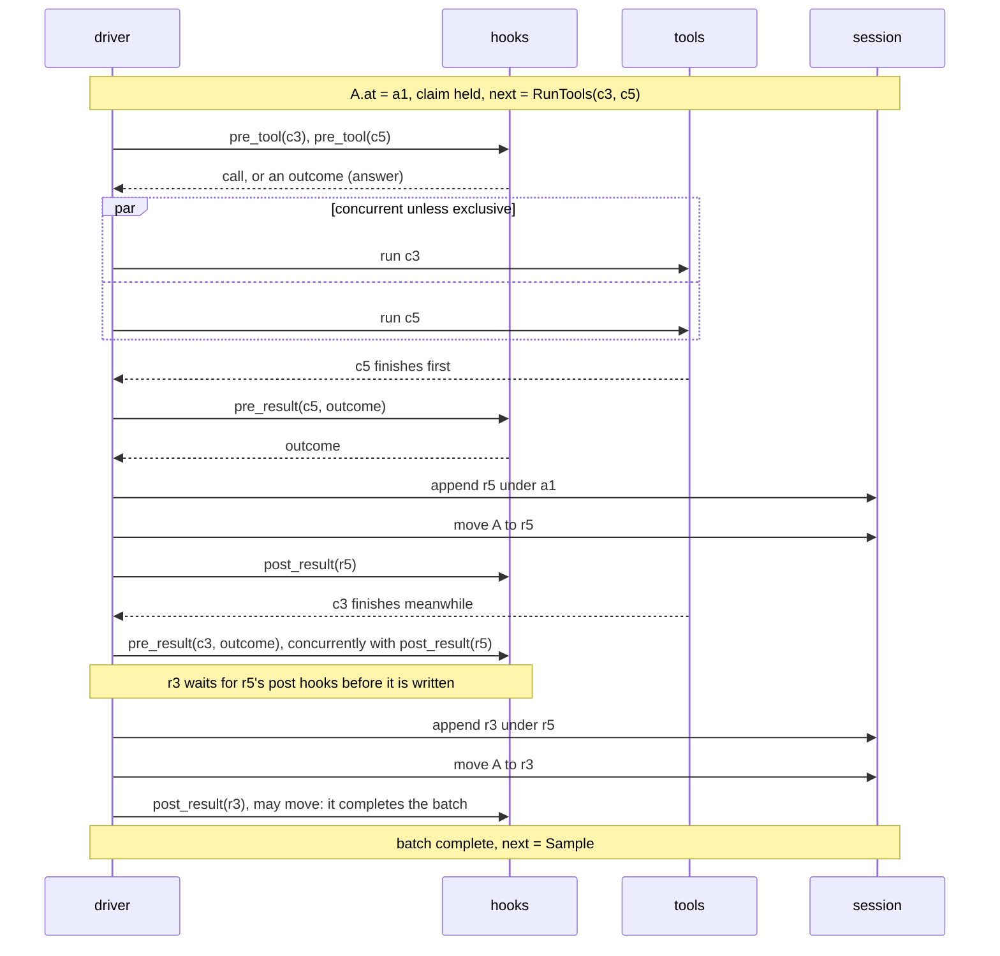

# 02 The step

A step is one cycle for one cursor. It has five phases: pre hooks on the
effect, the effect, pre hooks on the node, **write then move**, post hooks on
the written node. There are three step kinds. `input` has no effect; `sample`
makes one provider request and writes one `Assistant` node; `tools` runs every
unanswered call and writes one `Result` per call, moving onto each as it is
written. After the step the driver evaluates `next(walk(at))` and, with
auto-step on, keeps stepping until `next` is `Wait`. Pre hooks change what is
written; post hooks change what happens around a written node.

## The five phases

```
 1 pre hooks      2 effect         3 pre hooks       4 write + move       5 post hooks
   on the effect                     on the node       (durable together)   on the written node
 ────────────────────────────────────────────────────────────────────────────────────────────
 input   (none)        (none)        pre_input         append, move onto    post_input
 sample  pre_sample    provider      pre_reply         append, move onto    post_reply
 tools   pre_tool      run the tool  pre_result        append, move onto    post_result
         (per call)    (per call)    (per call)        (per result)         (per result)

 then: next(walk(at))  ──▶  Sample | RunTools | Wait
       auto-step on: step again until Wait       auto-step off: cursor pauses, already moved
```

Hooks at one point run in the order listed in `config_at(at)`; each gets what
the previous one returned.

## Sample step

```
 A.at = u1 (User)        next = Sample

 pre_sample(tip = u1)
   │  returns tip'   ......... u1 itself, a node it appended (a reminder), a Config
   │                           (model choice), or the end of a line it built (compaction)
   │  returns a reply  ....... ANSWER: provider not called, remaining pre_sample hooks skipped
   │  raises  ................ hook error: nothing written, auto-step off
   ▼
 driver: apply I6 to tip'   ·   can a reply be appended under tip'? (I4) else refuse the step
   ▼
 provider.sample( walk(tip'), config_at(tip') )          stream_delta events; parts accumulate
   ▼
 pre_reply(reply)
   │  returns reply' ......... parts possibly rewritten (guard, redaction), never `stop`;
   │                           also runs after an ANSWER
   │  returns nothing ........ REFUSE: nothing written, its calls never existed, auto-step off
   ▼
 append Assistant a2 under tip'     by provider   (extension(name) if answered or rewritten)
                                    (under I6's restating Config instead, if the driver appended one)
 move A: u1 ──▶ a2                  by core       commits tip''s line, then a2
   ▼
 post_reply(a2)           runs unless the step was aborted
   │  may append side nodes (scratch)
   │  may move the cursor, or rerun a batch (through api)
   ▼
 next(walk(at))
```

## Tools step

```
 A.at = a1 (Assistant, stop = tools, calls c3 and c5)     next = RunTools(c3, c5)
 A's step takes a1's claim (waits if another step holds it), re-reads the run

 per call                 pre_tool(call)
                            │ returns call'   rewritten (sandbox, remote host)
                            │ returns outcome ANSWER: Ok (cache, mock) or Skipped("blocked by ...")
                            │                 tool not run; pre_result still runs
                            │ raises          the call is answered Err("hook error") by core
                            ▼
                          run the tool      c3 and c5 run concurrently unless a tool is exclusive
                            ▼
                          pre_result(call', outcome)   as soon as this tool finishes, concurrently
                            │ returns an outcome of the same kind; content may be redacted
                            │ cannot drop it: every call is owed a result (I4)
                            ▼ (results wait in line, in completion order)
 one at a time per cursor append Result under the previous node (a1 for the first)
                          move A onto it                 by core
                          post_result(node) finishes     before the next outcome is written
                            │ may append side nodes
                            │ may move the cursor only on the result that completes the batch
```



A call whose `args_raw` does not parse is answered `Err("invalid arguments")`
(by core) without running. Results core writes (`Err("invalid arguments")`,
`Interrupted`, `Err("hook error")`, `Skipped("superseded by input")`) run no
hooks: no `pre_result`, no `post_result`. They are written and moved onto;
if one completes the batch, the driver evaluates `next` directly. Under a reply with any other `stop`, no call runs
and none is owed a result.

## Input step

```
 frontend gives input "/model fast"  ──▶  pre_input(user body)
   │  returns the body, possibly rewritten ......... written as User
   │  returns another body (a command is HANDLED) .. e.g. Config{...}, written and moved onto like input
   │  returns nothing ............................... REFUSE: nothing written, auto-step off
   ▼
 append (by frontend, or extension(name) if handled/rewritten); move A onto it (by core)
   ▼
 post_input(node)   may append, or move the cursor: write a sibling u1' with derived_from [u1]
   ▼                 and move onto it; the typed u1 stays, committed
 next(walk(at))
```

Input lands only where `next != RunTools`. If a step is running, the driver
keeps one input until the cursor reaches such a node; a second input while
one is kept is refused (D2: the queue is the frontend's). If `at` is an
unstarted or partial batch, the batch is answered first (Q17). Input under a
named parent (`Session.input(cursor, text, parent)`) is a go-to to that
parent, with fast-forward, I6, and the same refusals, followed by this step.

## What each hook may do

| hook point | rewrite | answer | refuse | append via `api` | move or re-run |
|---|---|---|---|---|---|
| `pre_input` | yes, or return another body (handled) | n/a | yes | any hook may | no |
| `pre_sample` | return a different tip | yes: a reply | no | yes (builds the tip) | no |
| `pre_reply` | yes | n/a | yes | any hook may | no |
| `pre_tool` | yes | yes: `Ok` or `Skipped` | no: answers `Skipped` instead | any hook may | no |
| `pre_result` | content only, never the kind (Q18) | n/a | no | any hook may | no |
| `post_input` | n/a | n/a | n/a | side nodes | yes |
| `post_reply` | n/a | n/a | n/a | side nodes | yes |
| `post_result` | n/a | n/a | n/a | side nodes | only on the completing result |

A pre hook steers only through its return value. A move by a post hook ends
that node's post hooks. Nodes and moves a hook writes trigger no hooks.

## Go to, re-run, and a hook's move

```
                    go to                     re-run                      hook's move
 call               Session.move             Session.rerun               Session.move via api
 caller             frontend                 frontend, or a post hook    post hook only
 move `by`          frontend                 frontend / extension(name)  extension(name)
 runs hooks         none                     its tools step runs hooks   none for the move; this node's
                                             as usual (pre_tool,         later post hooks are skipped; the
                                             pre_result, post_result)    step that follows runs hooks as usual
 starts a step      never, even with         yes: a tools step for each  takes effect when the post hooks
                    auto-step on             call unanswered on the new  finish; a hook's re-run does not
                                             line (after the post hooks, nest: its tools step runs then
                                             if a hook asked)
 afterwards         cursor sits (a User or   continues per auto-step     driver evaluates next, continues
                    unstarted batch waits)                               per auto-step; counts to max_steps
 lands              fast-forwards onto a     exactly where sent          fast-forwards, checked like a go-to
                    batch or its run
 claim              never taken              taken by its tools step     never taken
 I6                 applies                  applies                     applies
 refused when       restatement needed under nothing unanswered there;   same as go-to; the hook may catch it
                    an unstarted or partial  copied batch; restatement
                    batch; incomplete copied needed
                    batch
```

A step's own move (phase 4, and a fast-forward the step makes when it
re-reads a run) is none of these: it is never refused, and I6 does not apply
to it. Pre hooks and tools cannot move or re-run.

Reads with: `model.md` §5 (move, re-run), §6 (next), §7 (steps, hook points,
what each hook may do, hook errors), §8 (abort); invariants I1, I3, I4, I5, I6;
Q15, Q17, Q18, Q20, Q21, Q25; `glossary.md` terms step, hook, hook point,
answer, refuse, handled, auto-step, claim, re-run, go to.
